<div align="center">

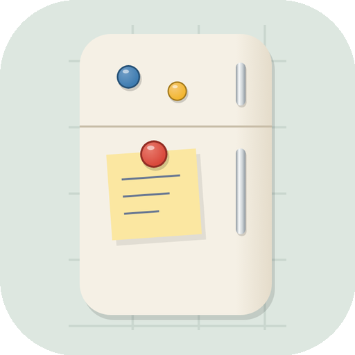

# Fridge

### A fridge door for two.

*The shopping list, whose turn it is, notes, asks without words, worries hung face down and confessions in sealed envelopes, all on one cream enamel door. The two phones are paired once with a QR code, then compare doors on their own whenever you're both at home on the same Wi-Fi. No server, no account, no cloud. Some things open only together. Free, no ads.*

[](https://github.com/bigdevwhale/fridge/actions/workflows/android.yml)
[](https://github.com/bigdevwhale/fridge/releases/latest)


[](LICENSE)

**English** · [Русский](README.ru.md) · [Changelog](CHANGELOG.md)

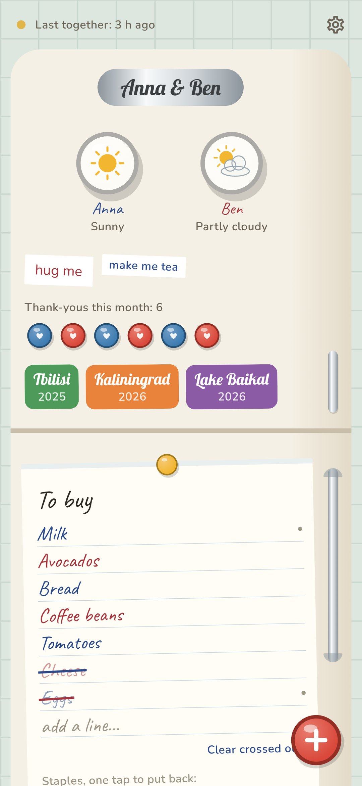 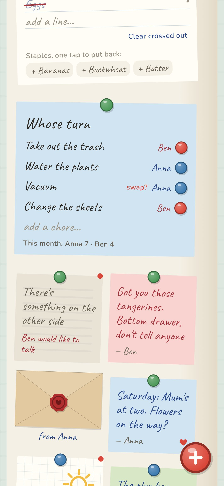 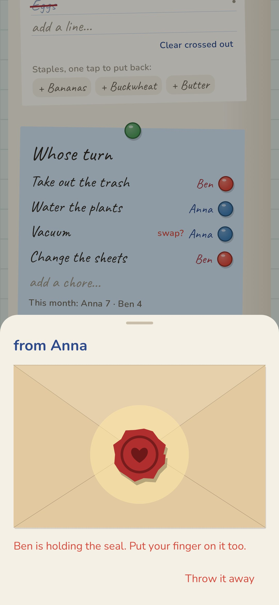 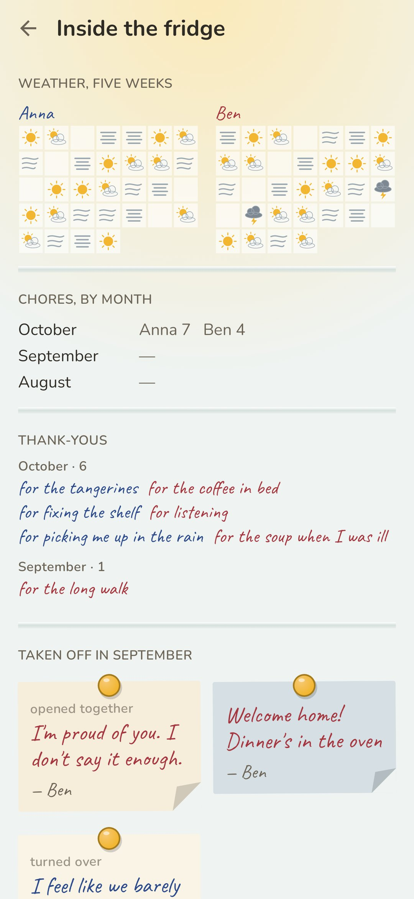

</div>

---

## The door

The whole app is one fridge. Each of you writes in your own ink, blue or red, the same on both phones.

**The freezer**
- **A nameplate** in chrome with your two names.
- **Today's weather** for each of you: a round magnet with sun, wind, fog, rain or a thunderstorm drawn on it. It tells how the day is going without having to explain.
- **Asks without words**: fridge-poetry word magnets such as *hug me*, *I need some quiet*, *make me tea* or *be gentle with me today*. The other one answers with *On my way*.
- **Thank-yous**: small round magnets with a heart that gather over the month.
- **Trip magnets**: a souvenir plaque for each place you've been together, with a photo on the back.

**The main door**
- **The shopping pad.** A line crossed out is crossed in the ink of whoever crossed it. Staples (milk, bread) go back to their jar when cleared, and one tap puts them back on the list.
- **Whose turn.** Each chore has the magnet of whoever is next. Doing a chore passes the turn to the other one. You can ask to swap, and the month's tally sits at the bottom as a plain fact.
- **Notes**, including **notes for the morning** that the other one sees only from six.
- **Face down.** A worry hangs with its back showing. The other one sees only that there is something, and turns it over when they can really listen: *I'm ready to listen* / *Not right now*. You can hang one a day, for the real things.
- **An envelope.** A confession under a wax seal. It opens only with both of your fingers on the seal at the same moment, each on your own phone, with the two phones together at home. Nobody can open it alone, not even the one who wrote it.
- **A drawing** with your finger on squared paper.
- **The hideout.** Each of you keeps wishes there. A "I'll see to it" mark on one of theirs is never shown to them, so a present stays a surprise.

Notes curl at the corner after a week on the door and yellow after a month. Pull the long chrome handle and **the fridge opens**. Under its lamp is everything taken off the door, shelved by month, plus five weeks of both your weather, chores by month, and every thank-you.

## How the two phones talk

1. **Pairing, once.** One phone shows a QR code and the other scans it. The code holds a 32-byte secret that only these two phones know.
2. **At home, by themselves.** Each phone calls out on the local network (mDNS plus a UDP broadcast, because routers differ) with a tag derived from the secret. When they find each other they open one TCP conversation, sealed with AES-GCM under the shared key, and swap whatever the other is missing.
3. **Live while together.** As long as the app is open on both phones, everything hung on one door appears on the other at once. A green lamp above the fridge shows it.
4. **In the background, if you like.** *Hum in the background* keeps listening at home with the app closed, so their notes are already there when you look, with a quiet notification.
5. **Apart for a while.** *Send a parcel* packs the whole door into one encrypted file. Send it through any messenger or Quick Share, and only the other phone can open it.

Every edit carries a Lamport version, so the later edit wins wherever it was made. Removals travel as tombstones, and nothing is lost when both phones change things apart.

## Privacy

There is no account, no server, no cloud, no analytics and no ads. Nothing leaves your home network except a parcel you choose to send, and that file is encrypted. The camera is used only to scan the pairing code.

## Screenshots

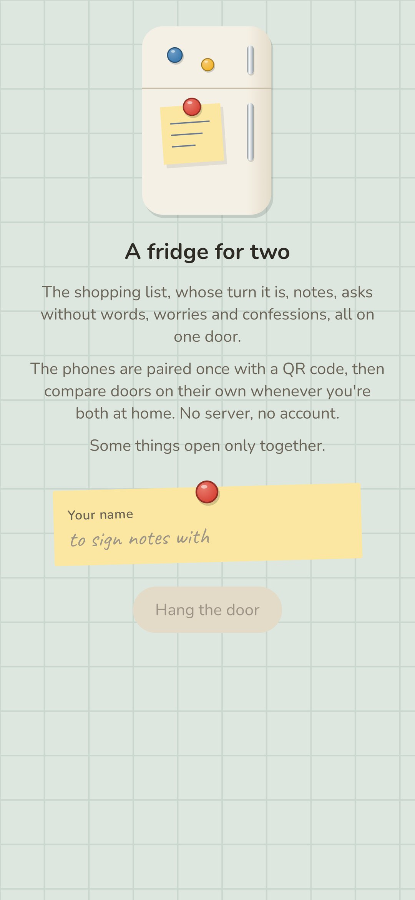   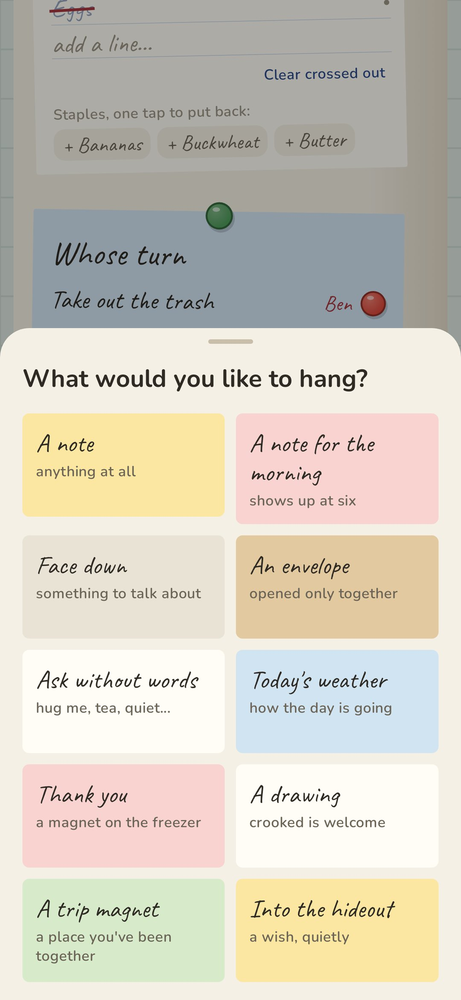 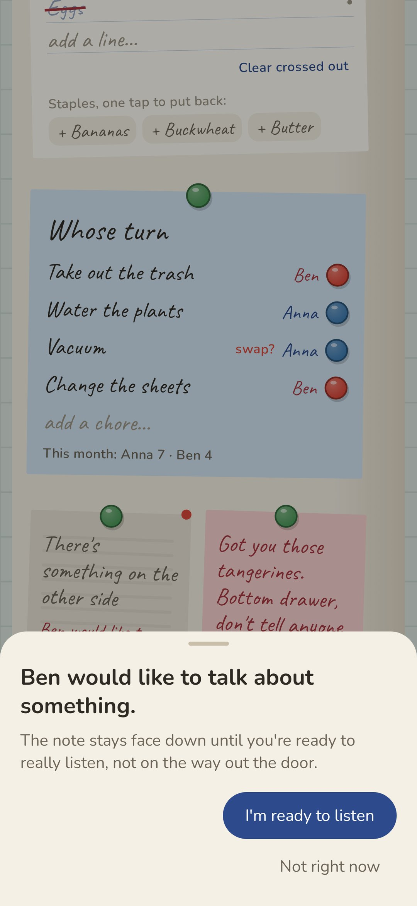  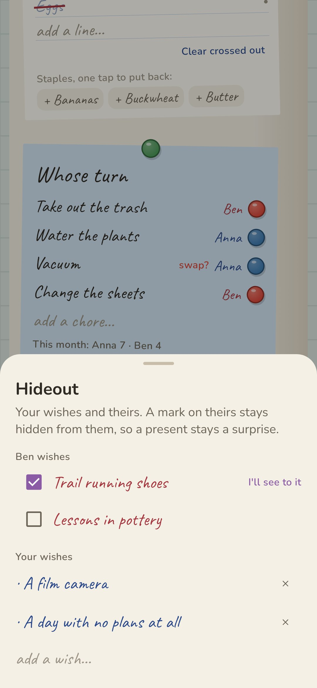  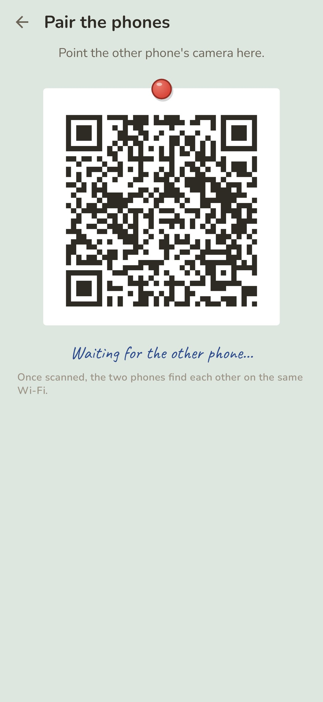 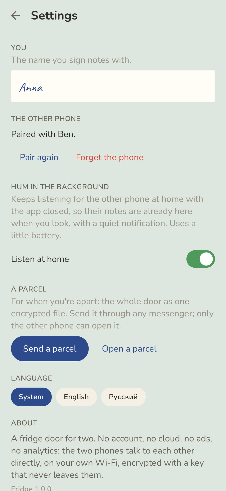

## Building

```
./gradlew assembleDebug                 # app.fridge.dev
./gradlew assembleDebug -Pdemo          # app.fridge.demo: a door already shared with a made-up partner
./gradlew testDebugUnitTest             # domain + two phones syncing over real sockets
./gradlew testDebugUnitTest -Prender --tests '*RenderArtScreens*' && python tools/shots.py   # screenshots
```

Kotlin, Jetpack Compose, Room, DataStore, and ZXing for the QR. Everything on the fridge is drawn in code. Android 9+.

## License

[MIT](LICENSE)
