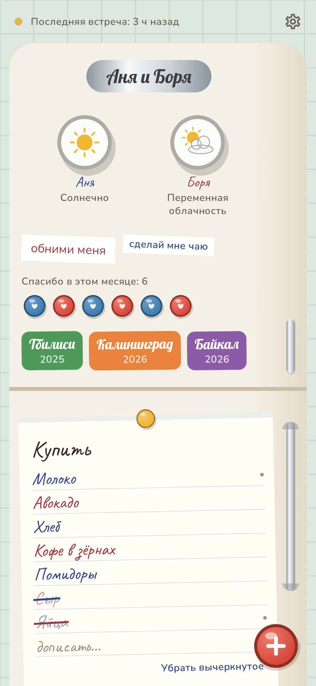
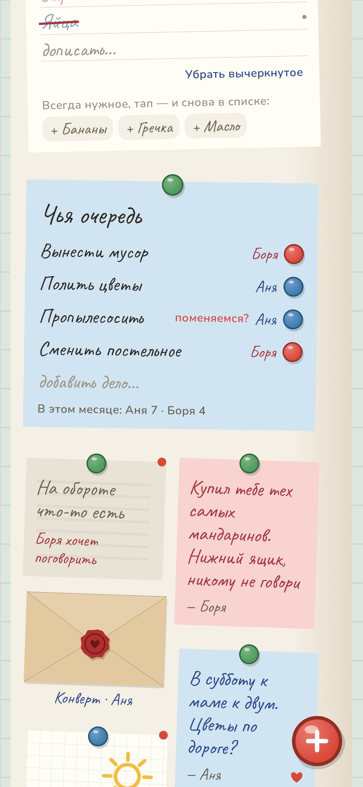
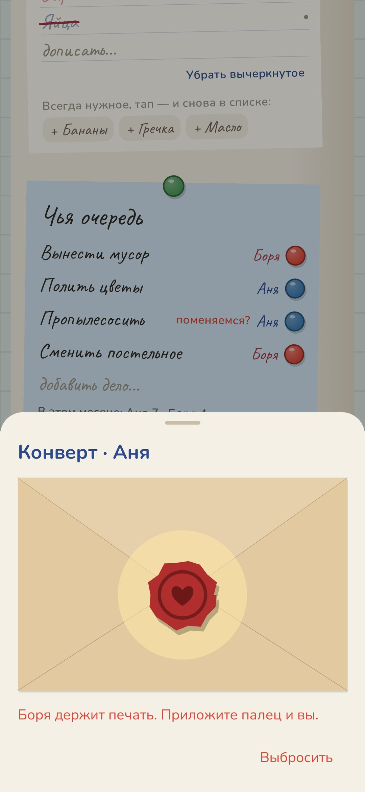
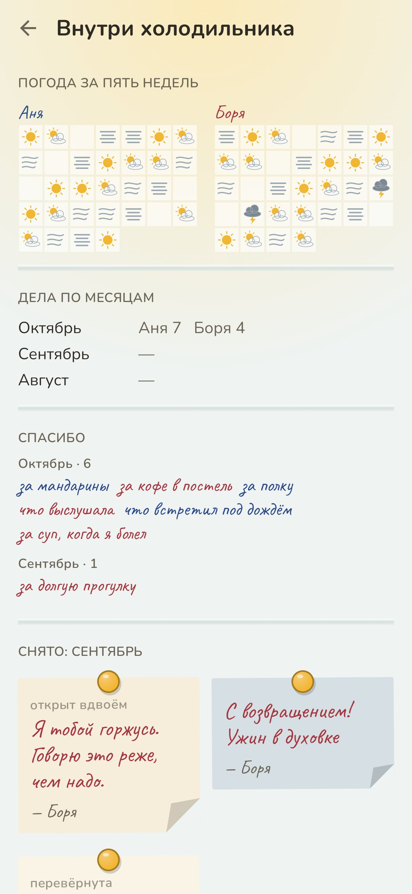
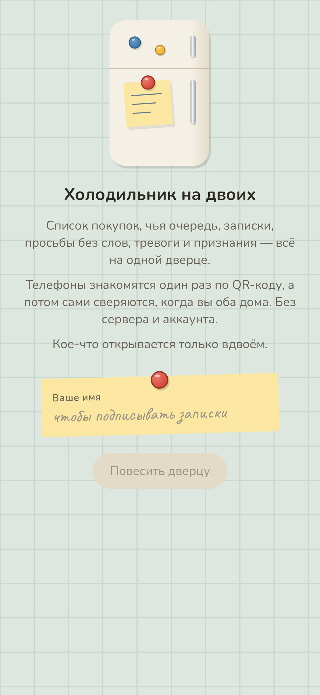
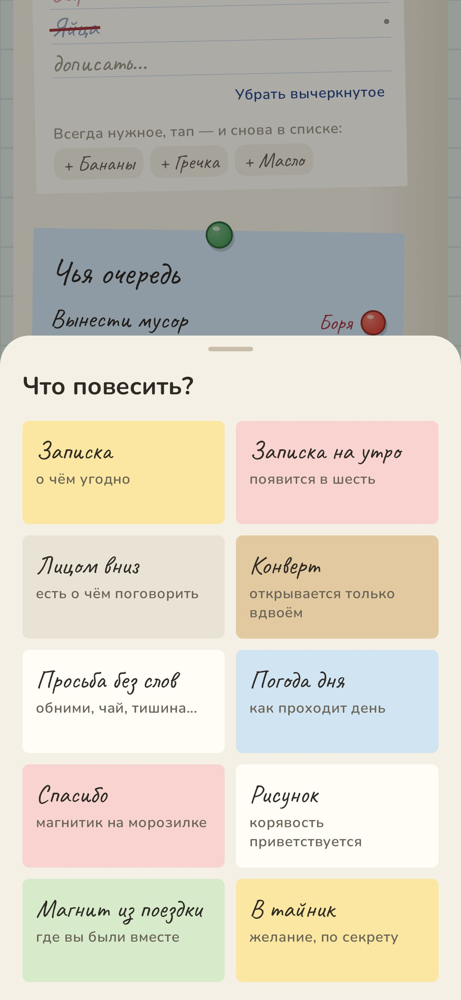
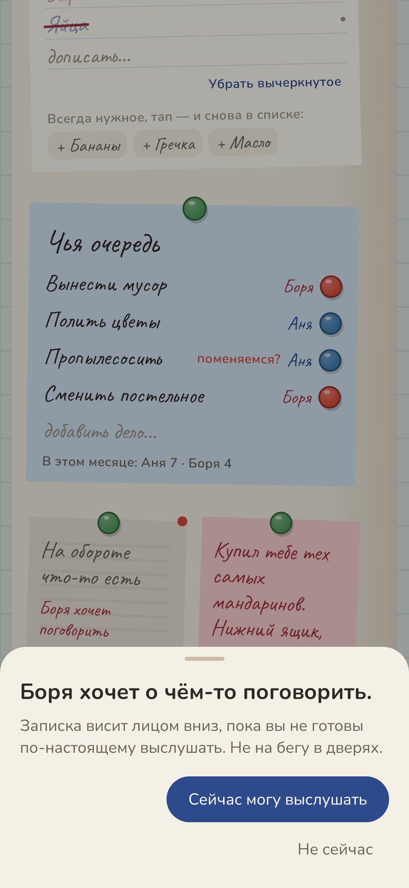
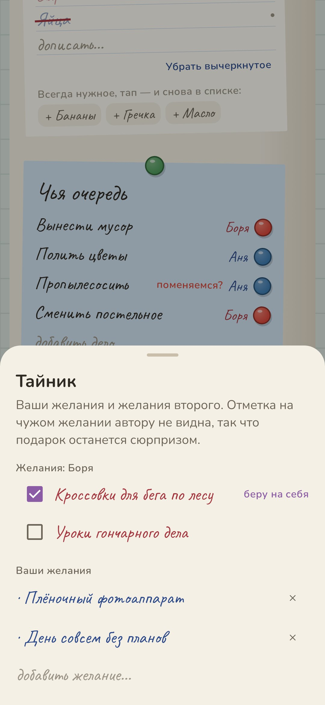
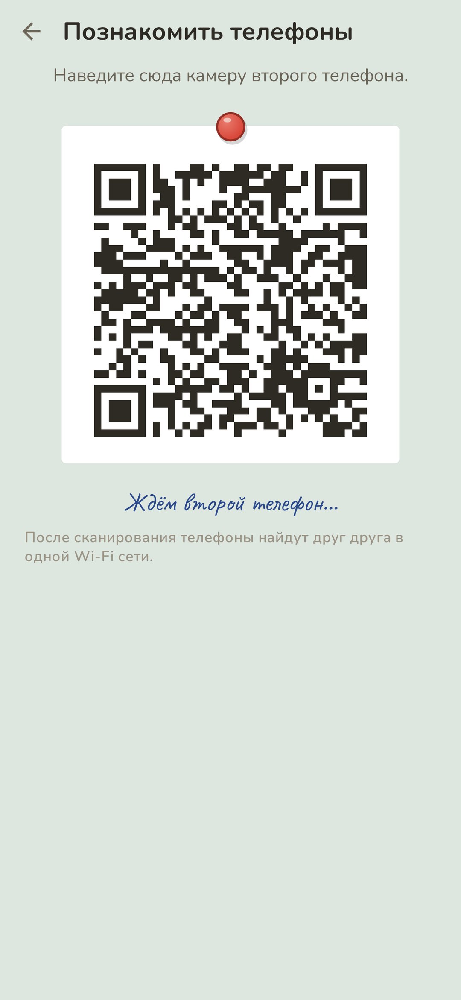
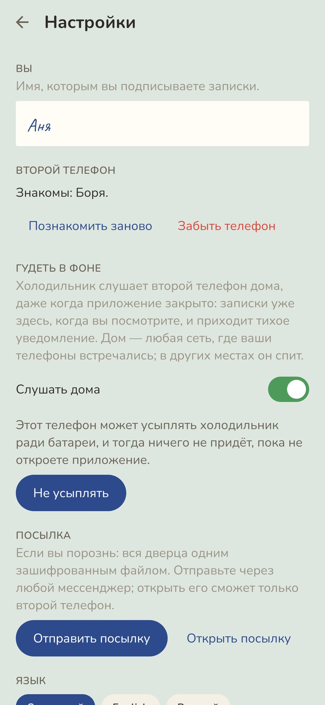

<div align="center">


# Холодильник

### Дверца холодильника на двоих.

*Список покупок, чья очередь, записки, просьбы без слов, тревоги лицом вниз и признания в запечатанных конвертах — всё на одной кремовой эмалевой дверце. Телефоны знакомятся один раз по QR-коду, а потом сами сверяются, когда вы оба дома, в одной Wi-Fi сети. Без сервера, аккаунта и облака. Кое-что открывается только вдвоём. Бесплатно и без рекламы.*

[](https://github.com/bigdevwhale/fridge/actions/workflows/android.yml)
[](https://github.com/bigdevwhale/fridge/releases/latest)


[](LICENSE)

[English](README.md) · **Русский** · [Изменения](CHANGELOG.md)

   

</div>

---

## Дверца

Всё приложение — один холодильник. Каждый пишет своими чернилами, синими или красными, одинаково на обоих телефонах.

**Морозилка**
- **Хромированная табличка** с вашими именами.
- **Погода дня** у каждого: круглый магнит с нарисованным солнцем, ветром, туманом, дождём или грозой. Видно, как проходит день, без объяснений.
- **Просьбы без слов**: магниты со словами — *обними меня*, *мне нужна тишина*, *сделай мне чаю*, *будь со мной бережнее сегодня*. Второй отвечает: *Иду*.
- **Спасибо**: маленькие круглые магниты с сердечком, за месяц их набирается россыпь.
- **Магниты из поездок**: сувенирная табличка за каждое место, где вы были вместе, с фото на обороте.

**Основная дверца**
- **Блокнот покупок.** Вычеркнутое вычеркнуто чернилами того, кто вычеркнул. Всегда нужное (молоко, хлеб) после уборки уходит «в банку» и возвращается в список одним тапом.
- **Чья очередь.** У каждого дела магнит того, кто следующий. Сделал — очередь переходит ко второму. Можно попросить поменяться, а внизу — простой счёт за месяц.
- **Записки**, в том числе **записки на утро**: второй увидит их только с шести.
- **Лицом вниз.** Тревога висит оборотом наружу. Второй видит лишь, что что-то есть, и переворачивает, когда может по-настоящему выслушать: *Сейчас могу выслушать* / *Не сейчас*. Одна в день — для настоящего.
- **Конверт.** Признание под сургучной печатью. Открывается, только когда вы оба одновременно держите пальцы на печати, каждый на своём телефоне, и телефоны вместе дома. В одиночку не откроет никто, даже автор.
- **Рисунок** пальцем на листке в клетку.
- **Тайник.** Желания каждого. Отметка «беру на себя» на чужом желании автору не видна — подарок остаётся сюрпризом.

Через неделю на двери у записок загибается уголок, через месяц они желтеют. Потяните длинную хромированную ручку — и **холодильник откроется**: под лампочкой на полках по месяцам лежит всё снятое с двери, погода за пять недель, дела по месяцам и все «спасибо».

## Как телефоны говорят друг с другом

1. **Знакомство — один раз.** Один телефон показывает QR-код, второй сканирует. В коде 32-байтный секрет, который знают только эти два телефона.
2. **Дома — сами.** Каждый телефон зовёт в локальной сети (mDNS и UDP-broadcast — роутеры бывают разные) меткой, выведенной из секрета. Найдя друг друга, они открывают один TCP-разговор, запечатанный AES-GCM общим ключом, и передают недостающее.
3. **Вживую, пока вместе.** Пока приложение открыто на обоих, всё повешенное на одну дверцу сразу появляется на другой; над холодильником горит зелёная лампочка.
4. **В фоне — дома.** Сразу после знакомства приложение спрашивает, слушать ли дома в фоне (по умолчанию — да). Тогда даже с закрытыми приложениями телефоны находят друг друга дома, а новое приходит тихим уведомлением. В проверке правка пришла через 3 секунды после того, как второй телефон вернулся в домашнюю Wi-Fi сеть.
   - **«Дом» — сеть, где ваши телефоны уже встречались.** Телефон запоминает адрес роутера и адрес сети, но не имя Wi-Fi (Android выдаёт его только с доступом к геолокации) и никогда не местоположение.
   - В других местах, на мобильном интернете или на работе, фоновый режим спит. Открытое приложение ищет второй телефон в любой сети.
   - Кнопка **«Не усыплять»** просит Xiaomi и других любителей замораживать приложения не трогать холодильник.
5. **Если вы порознь.** «Отправить посылку» — вся дверца одним зашифрованным файлом через любой мессенджер или Quick Share; открыть её сможет только второй телефон.

У каждой правки есть версия Лэмпорта: побеждает более поздняя, где бы её ни сделали. Удаления передаются «надгробиями», и ничего не теряется, когда оба меняли что-то порознь.

## Приватность

Без аккаунта, сервера, облака, аналитики и рекламы. Из дома ничего не уходит, кроме посылки, которую вы сами отправите, и она зашифрована. Камера нужна только чтобы отсканировать код знакомства.

## Скриншоты

         

## Сборка

```
./gradlew assembleDebug                 # app.fridge.dev
./gradlew assembleDebug -Pdemo          # app.fridge.demo: дверца, уже общая с выдуманной половинкой
./gradlew testDebugUnitTest             # логика + два телефона, синхронизирующиеся по настоящим сокетам
./gradlew testDebugUnitTest -Prender --tests '*RenderArtScreens*' && python tools/shots.py   # скриншоты
```

Kotlin, Jetpack Compose, Room, DataStore, ZXing для QR. Всё на холодильнике нарисовано кодом. Android 9+.

## Лицензия

[MIT](LICENSE)
